# Franka Panda Pick-and-Place Using Inverse Kinematics

## Abstract

This project implements and compares three inverse-kinematics methods for
pick-and-place manipulation using a Franka Panda robot in MuJoCo: Mink IK,
Damped Least-Squares (DLS) IK, and a custom quadratic-programming (QP) IK
method. Workspace sampling, kinematic waypoint validation, and randomized
pick-and-place benchmarks are used to evaluate reachability and controller
performance.

The latest recorded 25-episode comparison achieved success rates of 72% for
Mink, 68% for DLS, and 72% for custom QP. DLS had the lowest mean episode
time. However, all three methods recorded joint-position or joint-speed
constraint violations, so their results do not establish complete constraint
compliance.

## 1. Objectives

The objectives of this project are to:

1. Analyze the Franka Panda task and dexterous workspaces.
2. Design a simulated environment containing a table, cube, and tray.
3. Evaluate pick-and-place target reachability.
4. Implement and compare Mink, DLS, and custom QP inverse kinematics.
5. Test randomized cube positions and orientations.
6. Record success, time, IK iterations, constraint violations, and failures.
7. Compare the methods and identify limitations and failure cases.

## 2. Simulation Environment and Geometry

The simulation uses the Franka Panda model and scene files:

- `robot_descriptions/franka_emika_panda/panda.xml`
- `robot_descriptions/franka_emika_panda/pick_place_scene.xml`

The scene geometry is defined using MuJoCo box geoms. Their XML `size`
attributes give half-dimensions, so the full dimensions are twice those
values.

### 2.1 Table

The table body is positioned at (0.45, 0.00, 0.30) m. The tabletop box has
half-dimensions (0.35, 0.45, 0.025) m.

Therefore, the tabletop dimensions are:

- Length: 0.70 m
- Width: 0.90 m
- Thickness: 0.05 m
- Top surface height: 0.325 m

### 2.2 Cube

The cube begins at (0.45, 0.00, 0.35) m and has half-dimensions
(0.025, 0.025, 0.025) m.

Therefore, the cube dimensions are 0.05 m × 0.05 m × 0.05 m. Its mass
specified in the scene is 0.08 kg.

The initial cube center is 0.025 m above the tabletop surface, consistent
with a cube of 0.025 m half-height resting on the table.

### 2.3 Tray

The tray body is positioned at (0.65, 0.20, 0.335) m. Its base has
half-dimensions (0.12, 0.12, 0.01) m.

The tray base is therefore 0.24 m × 0.24 m × 0.02 m. Its upper surface is
at z = 0.345 m. Four wall boxes define the tray perimeter. The nominal
inner opening is approximately 0.20 m × 0.20 m, based on the wall
positions and thicknesses specified in the scene.

### 2.4 Design Justification

The table provides a horizontal work surface for the cube, while the tray
is offset from the initial cube position so that the robot must perform
transport rather than only vertical movement.

The workspace plots are used to assess the spatial relationship between
the robot and the selected pick-and-place region. The table and tray
dimensions are taken directly from the current scene file.

Workspace sampling and kinematic reachability are approximate diagnostics.
They do not prove that every point can be reached along a collision-free
trajectory or that a physical grasp will succeed.

## 3. Workspace Analysis

The workspace analysis sampled 20,000 joint configurations. The dexterous
workspace summary reports 160 candidate positions tested across eight yaw
targets:

- -3.142 rad
- -2.356 rad
- -1.571 rad
- -0.785 rad
- 0.000 rad
- 0.785 rad
- 1.571 rad
- 2.356 rad

The summary reports 160 candidates meeting its stated dexterity criterion:
at least half of the tested yaw targets were solved within the selected IK
tolerances and joint limits.

These values are approximate and depend on random sampling, IK convergence,
the selected hand-body reference, and the numerical tolerances.

### Workspace Figures

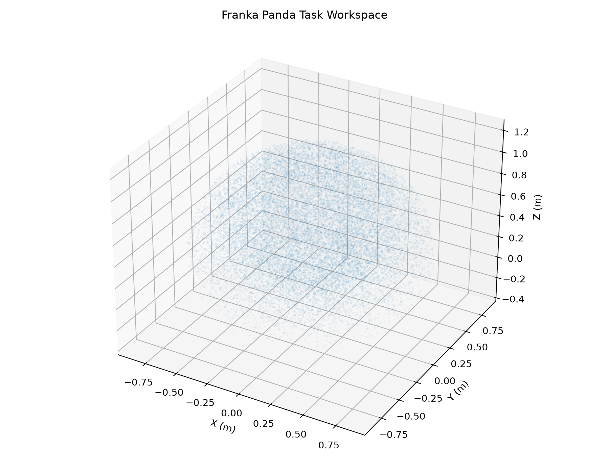

*Figure 1. Sampled three-dimensional task workspace.*

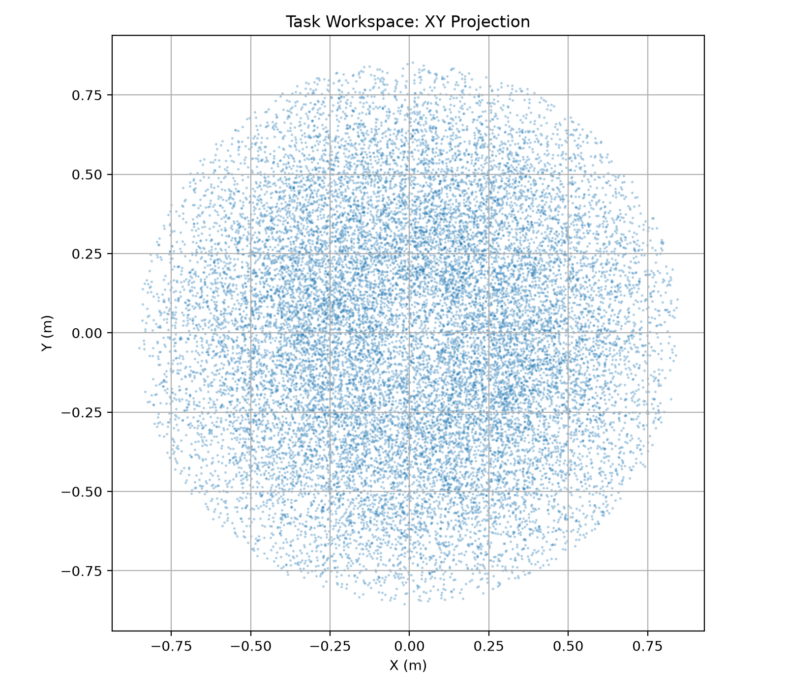

*Figure 2. Top-view projection of the sampled task workspace.*

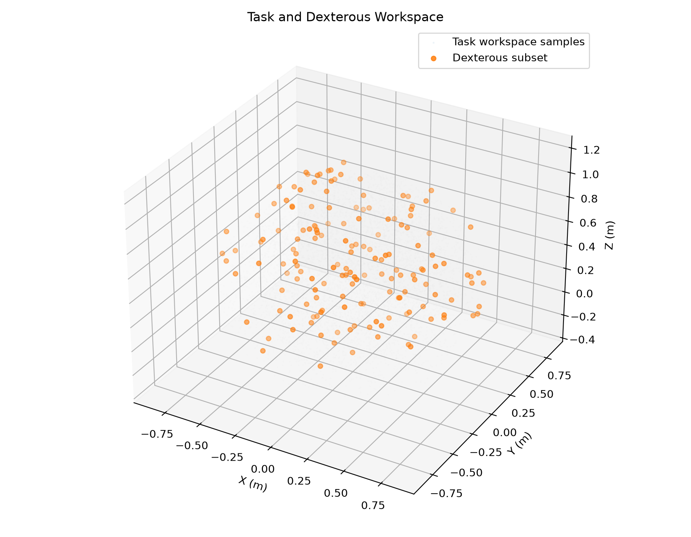

*Figure 3. Comparison of task-workspace samples and the estimated
dexterous subset.*

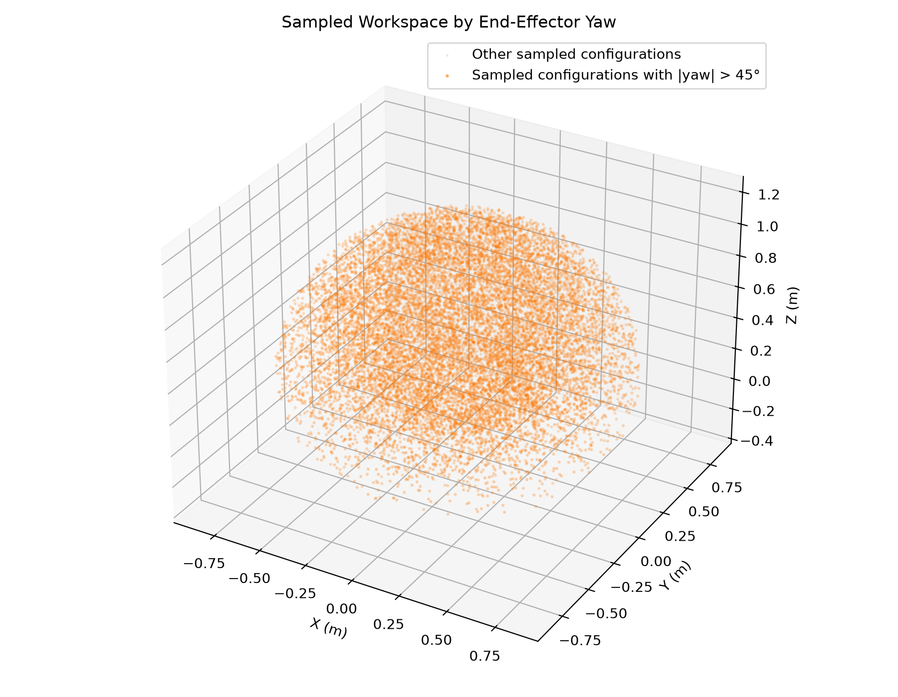

*Figure 4. Workspace analysis for the tested yaw orientations.*

## 4. Pick-and-Place Waypoint Validation

Two waypoint-validation studies were recorded.

### 4.1 Kinematic IK Validation

The kinematic validation tested 25 seeded poses:

- Pre-grasp reached: 24/25 (96%).
- Grasp-approach waypoint reached after pre-grasp: 24/24 attempted cases.
- Both waypoints reached: 24/25 (96%).
- Elapsed wall time: 10.49 s.

This test evaluates numerical IK reachability. It does not simulate a
complete physical pick-and-place episode.

### 4.2 Actuator-Aligned Validation

The actuator-aligned validation included actuator commands, settling steps,
and MuJoCo stepping for 25 seeded poses:

- Pre-grasp reached: 17/25 (68%).
- Grasp-approach waypoint reached after pre-grasp: 17/17 attempted cases.
- Both waypoints reached: 17/25 (68%).
- Elapsed wall time: 14.15 s.

This validation evaluates only the first two waypoints. It does not establish
gripper contact, cube lift, transport to the tray, or final placement.

### Validation Figures

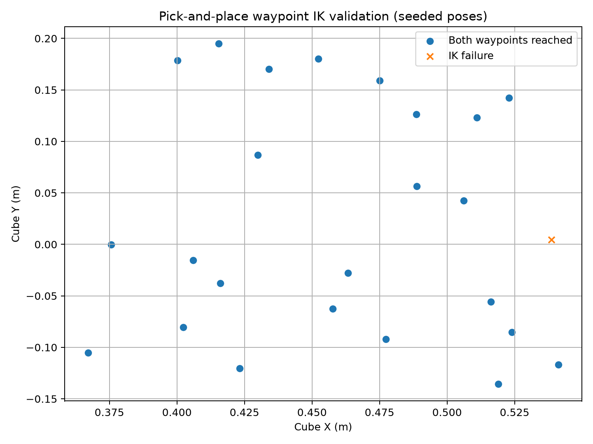

*Figure 5. Kinematic pick-and-place waypoint validation.*

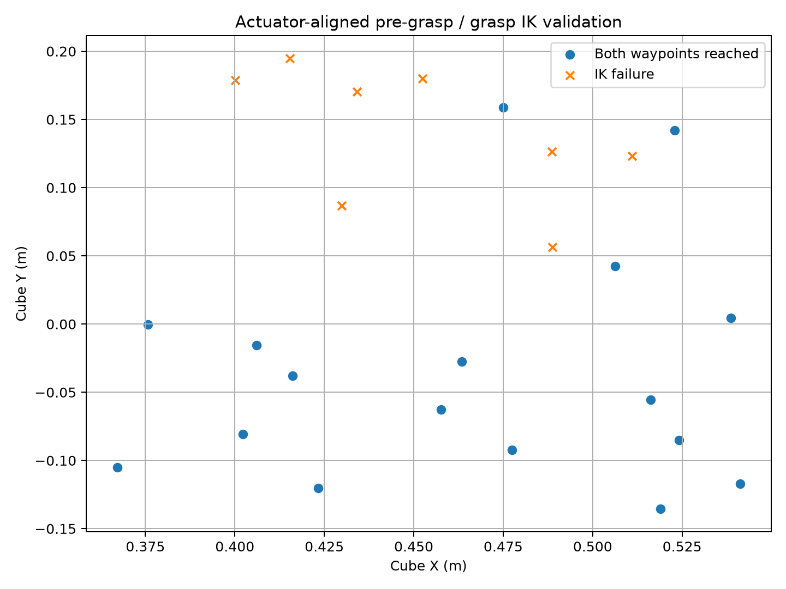

*Figure 6. Actuator-aligned waypoint validation.*

## 5. Inverse-Kinematics Methods

### 5.1 Mink IK

Mink is used as the off-the-shelf IK framework, with the DAQP solver and a
Cartesian task. The controller follows a smoothed Cartesian target trajectory
and updates the robot's commanded joint positions.

### 5.2 Damped Least-Squares IK

DLS calculates joint updates using the Jacobian and a damping term. Damping
helps regularize the inverse near singular configurations. The resulting
joint updates are limited before they are sent to the actuators.

### 5.3 Custom QP IK

The custom QP method formulates a regularized Cartesian task-error objective
and includes joint-position bounds and per-step motion limits. It is evaluated
with the same nominal set of randomized cube poses.

The methods are compared using the saved benchmark data. Controller
differences, actuator dynamics, convergence behaviour, and the selected
constraints can affect the final results.

## 6. Randomized Benchmark Protocol

Each method was run for 25 episodes using seed base 0. The recorded
comparison confirms that Mink, DLS, and custom QP used the same initial
cube positions and yaw angles.

The latest benchmark scripts use a commanded arm-speed cap of 0.30 rad/s
and reduced arm actuator position-servo stiffness for the speed-cap
experiments. Measured joint velocities are checked against a threshold of
0.45 rad/s.

The commanded speed cap and measured joint speed are distinct quantities.
The arm's simulated actuator response may produce actual speeds above
the commanded cap.

## 7. Comparative Results

### 7.1 Success and Computation

| Metric | Mink | DLS | Custom QP |
|---|---:|---:|---:|
| Episodes tested | 25 | 25 | 25 |
| Successful episodes | 18 | 17 | 18 |
| Success rate | 72% | 68% | 72% |
| Mean episode time | 2.693 s | 2.321 s | 2.841 s |
| Median episode time | 2.861 s | 2.453 s | 2.943 s |
| Mean IK iterations | 6906.3 | 6913.3 | 7556.1 |

Mink and custom QP recorded the highest success rate, at 72%. DLS recorded
the lowest mean episode time, at 2.321 s. Custom QP had the highest mean
iteration count and mean episode time among the three methods.

### 7.2 Constraint Measurements

| Metric | Mink | DLS | Custom QP |
|---|---:|---:|---:|
| Episodes with joint-position violations | 4 | 2 | 1 |
| Joint-position violation samples | 148 | 644 | 1294 |
| Maximum position-limit excursion | 0.00000476 rad | 0.00000837 rad | 0.02905336 rad |
| Episodes exceeding 0.45 rad/s | 7 | 4 | 9 |
| Speed-violation samples | 162 | 566 | 7359 |
| Peak measured joint speed | 1.173052 rad/s | 1.283431 rad/s | 4.240162 rad/s |

The measured data show constraint violations for every method. Although DLS
had fewer episodes exceeding the velocity threshold, its peak measured
speed also exceeded the threshold. The custom QP results include a
substantially higher peak speed and maximum position-limit excursion,
which warrant further investigation.

Accordingly, the benchmark does not establish full speed or joint-position
compliance for any method. The peak-speed values should be interpreted
alongside the joint-state sampling and constraint-checking implementation.

### 7.3 Comparative Figures

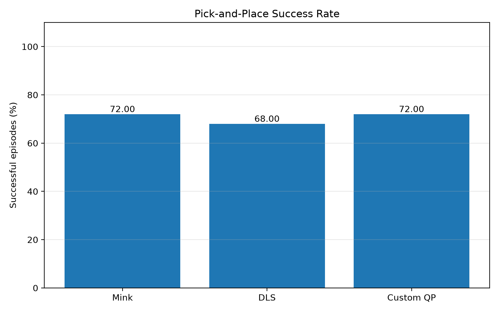

*Figure 7. Success rate for the three IK methods.*

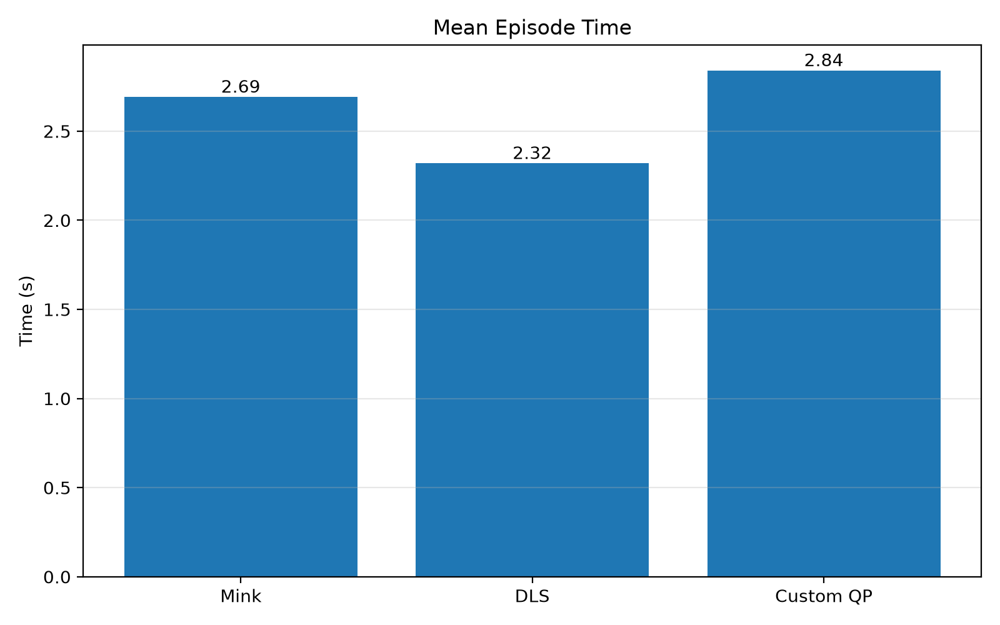

*Figure 8. Mean computation time per episode.*

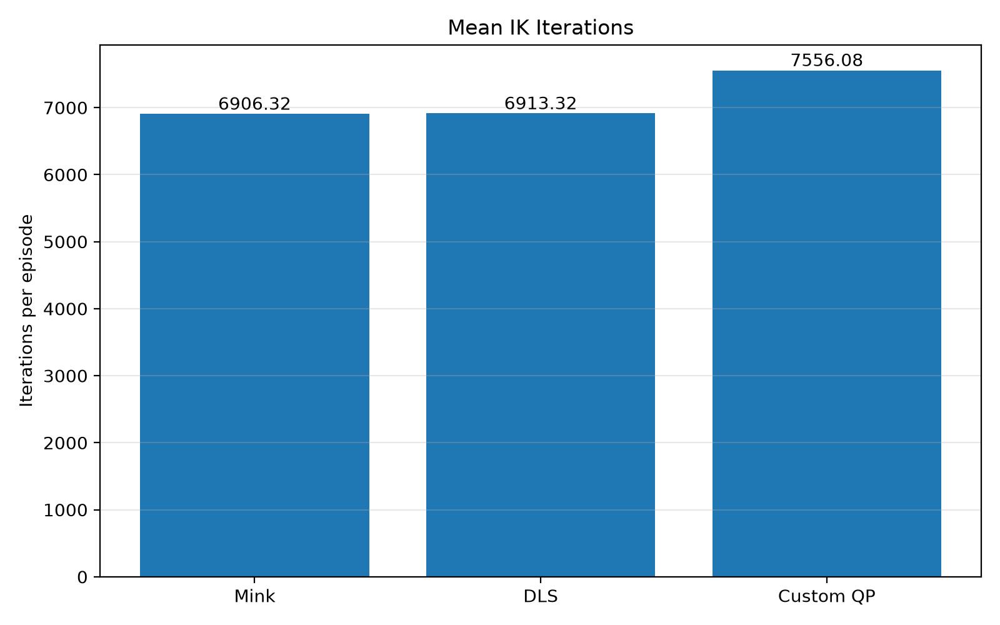

*Figure 9. Mean number of IK iterations.*

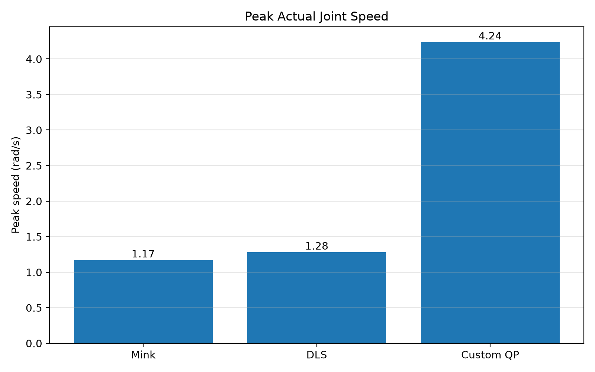

*Figure 10. Peak measured joint speed.*

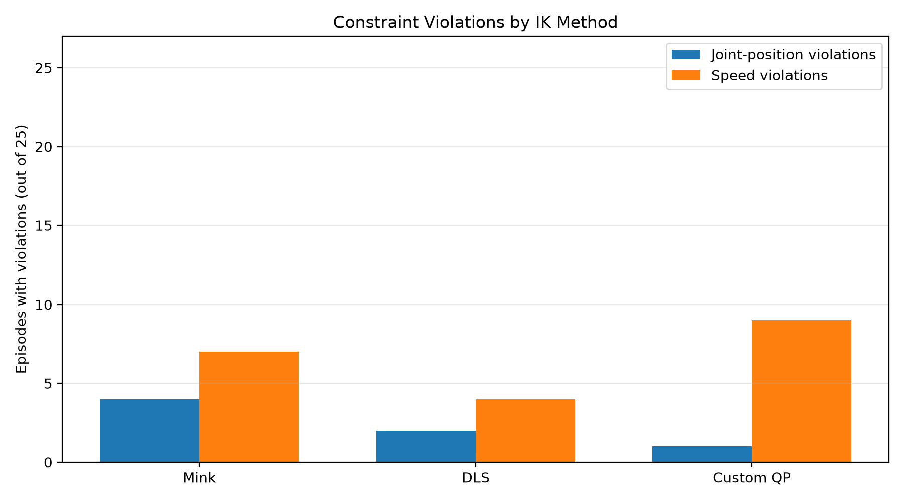

*Figure 11. Episode-level joint-position and joint-speed violations.*

The machine-readable comparative data are in
`results/final_ik_comparison_speedcap.csv`.

## 8. Failure Analysis

The recorded benchmark logs contain failures at different stages of the
pick-and-place task. The failure-analysis CSV records the method, episode,
seed, failure reason, initial cube pose, yaw, and available phase and
constraint metrics.

The principal failure categories to investigate are:

1. IK non-convergence during pre-grasp or transport.
2. Grasp-check failure when the cube does not rise as required.
3. Placement-check failure when the cube is not confirmed inside the tray.
4. Joint-position or joint-speed constraint violations.

A failed waypoint is not equivalent to a failed physical grasp, and a
successful waypoint is not equivalent to a successful full episode. The
reason and phase recorded in each episode's log should be used when
classifying each failure.

Representative MuJoCo failure screenshots must be added to
`failure_screenshots/` and referenced in the final submission. The screenshots
should show the relevant failure state, with the corresponding episode and
failure reason stated in the caption.

## 9. Discussion

The recorded comparison highlights a trade-off between task success and
computation time. Mink and custom QP reached 72% success, while DLS reached
68% and had the shortest mean episode time.

However, the measured joint constraints are important to the final
assessment. DLS had fewer episodes exceeding 0.45 rad/s than the other
methods, but its peak measured speed still exceeded that limit. The custom
QP run recorded the largest peak speed and maximum joint-position excursion.
The constraint metrics therefore identify further work required to make the
controller behaviour more reliable.

The waypoint-validation tests also show why kinematic and actuator-aligned
results should be reported separately: 24/25 poses reached both waypoints
in the kinematic diagnostic, compared with 17/25 in the actuator-aligned
diagnostic. Neither diagnostic validates the complete physical task.

## 10. Limitations

- The task and dexterous workspaces are estimated by finite sampling.
- Kinematic waypoint reachability does not establish a collision-free path.
- The actuator-aligned validation does not include the complete grasp,
  lift, transit and placement sequence.
- The randomized benchmark contains unsuccessful episodes.
- All three methods recorded measured constraint violations.
- The benchmark results depend on the model, controller settings,
  tolerances, and software versions.
- The final failure-case screenshots and three-minute video must accompany
  the report to complete the submission.

## 11. Conclusion

The project implements and compares three IK methods for Franka Panda
pick-and-place in MuJoCo and includes sampled workspace analysis,
waypoint-validation tests and randomized benchmark measurements.

In the current 25-episode comparison, Mink and custom QP achieved the
highest task success rate at 72%, while DLS had the shortest mean episode
time and the fewest episodes exceeding the 0.45 rad/s threshold. The
constraint measurements show that none of the tested configurations
satisfied all recorded constraints in every episode.

The next steps are to attach representative failure screenshots, finalize
the demonstration video, verify the repository instructions, and package the
code, logs, plots, and report for submission.

## 12. Reproducibility and Software

The scene and robot model files are under
`robot_descriptions/franka_emika_panda/`. The workspace, validation, and
benchmark scripts are under `scripts/`. Benchmark JSON logs and summary CSV
files are under `results/`, and plots are under `plots/`.

The development environment recorded:

- MuJoCo 3.11.0
- NumPy 2.5.2
- Matplotlib 3.11.1

The full software environment should be checked against
`results/software_versions.txt` before attempting to reproduce the results.
Retain the robot-description license and attribution files when redistributing
the model and its assets.
