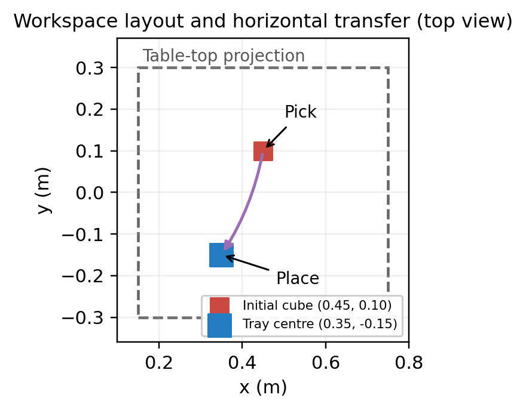
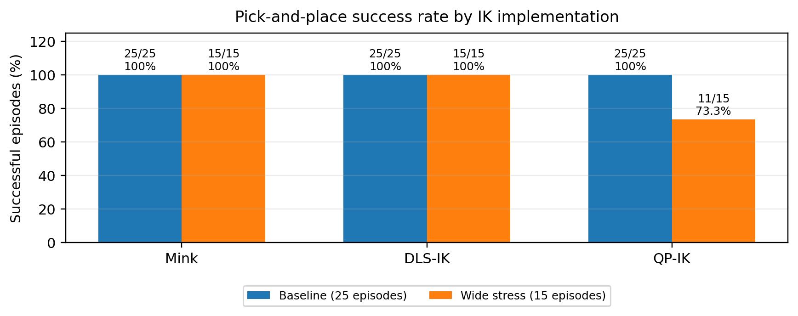
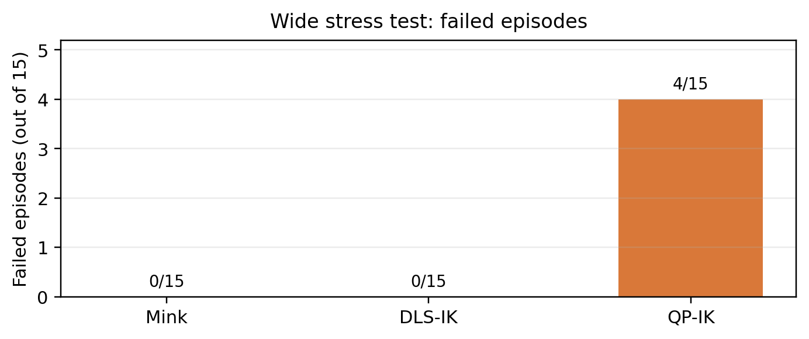
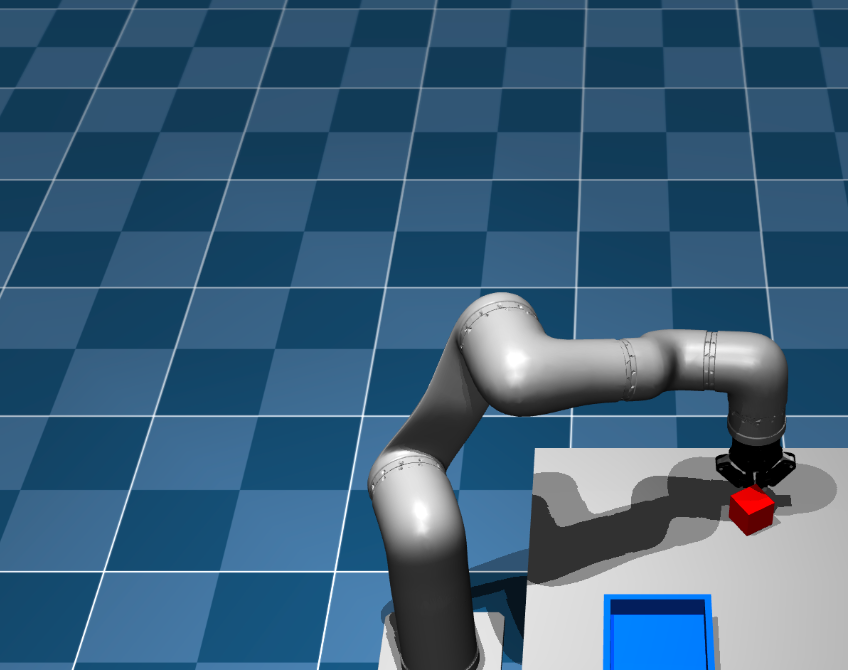

# HEAL Robot Pick-and-Place: Three IK Methods

**ITR Lab 3 | MuJoCo simulation**
**Methods:** Mink + DAQP, damped least-squares IK (DLS-IK), and constrained QP-IK
**Robot/end effector:** HEAL arm with Robotiq 2F-85 gripper

## Abstract

This project implements an end-to-end simulated cube pick-and-place task using a HEAL robotic arm equipped with a Robotiq 2F-85 gripper. Three inverse-kinematics/control implementations were exercised: Mink's `FrameTask` solved with DAQP, a damped least-squares Cartesian-velocity controller, and a constrained quadratic-programming controller. The trajectory approaches the cube, descends, closes the gripper, verifies lifting, carries the cube above a tray, lowers, releases, and retreats.

All methods completed 25/25 baseline episodes. In a wider stress test, Mink and DLS-IK completed 15/15 episodes and QP-IK completed 11/15. A replay of QP-IK Episode 15 detected no finger-pad contact and measured 0.0422 m of horizontal cube displacement during closing; the controller rejected the grasp and stopped before lift.

## 1. Scene design and waypoints

The worktable was placed in front of the robot while preserving the robot's original orientation. This avoids an unnecessary base rotation and keeps the task targets reachable in the current setup.

| Scene item | Position/value | Meaning |
|---|---:|---|
| Table body | `(0.45, 0.00, 0.10) m` | Front-table work surface |
| Nominal cube centre | `(0.45, 0.10, 0.225) m` | 50 mm cube initial centre |
| Tray reference centre | `(0.35, -0.15, 0.205) m` | Destination region |
| Cube mass in stress scene | `0.050 kg` | Cube used for evaluation |
| Table top height | `z = 0.20 m` | Inferred from body centre and half-height |

| Waypoint | Cartesian target `(x, y, z)` in metres | Purpose |
|---|---|---|
| Pre-grasp | `(0.45, 0.10, 0.45)` | Approach above cube |
| Grasp | `(0.45, 0.10, 0.36)` | Descend and close gripper |
| Lift/carry height | `(0.45, 0.10, 0.48)` | Raise for tray clearance |
| Tray hover | `(0.35, -0.15, 0.48)` | Transfer above tray |
| Place | `(0.35, -0.15, 0.375)` | Lower for release |

The final trajectory separates the phases: lift vertically first, move horizontally at clearance height, descend into the tray, open the gripper, and retreat vertically. This was adopted after earlier trajectories dragged the cube into tray boundaries.

## 2. IK and control implementations

| Method | Implementation used | Important comparison caveat |
|---|---|---|
| **Mink** | Mink `FrameTask` with DAQP; IK is solved at Cartesian targets and resulting joint configurations are interpolated. | Motion uses joint-space interpolation between IK target configurations. |
| **DLS-IK** | Damped least-squares Jacobian maps Cartesian pose error/feedforward velocity to joint velocity; torque-limited PD tracks the reference. | Cartesian velocity tracking with damping. |
| **QP-IK** | Projected accelerated-gradient QP with joint-speed and one-step joint-position bounds; torque-limited PD tracks the reference. | Bounds are enforced in the QP calculation. |

These are comparisons of complete controller/task implementations, not a perfectly isolated comparison of the numerical solvers: Mink uses joint-space interpolation while DLS and QP track Cartesian velocity paths.

## 3. Evaluation and results

The baseline ran 25 episodes per method, with cube x/y offsets sampled within ±0.02 m. The wide stress test ran 15 episodes per method with x/y offsets within ±0.12 m. For each episode, the same initial offset was used across the three methods. **The PREGRASP, GRASP, and LIFT x/y targets were shifted with the cube**, so the wide test is not a fixed-target robustness test.

| Test | Mink | DLS-IK | QP-IK | Total |
|---|---:|---:|---:|---:|
| Baseline, 25 episodes/method | 25/25 (100%) | 25/25 (100%) | 25/25 (100%) | 75/75 |
| Wide stress, 15 episodes/method | 15/15 (100%) | 15/15 (100%) | 11/15 (73.3%) | 41/45 |

QP-IK did not verify success in Episodes 7, 8, 13, and 15. Mink and DLS-IK had no failures in this 15-episode stress sample. These are observed sample results, not evidence that the first two methods always succeed.

## 4. Failure analysis: QP-IK Episode 15

Episode 15 (seed `12014`) was replayed using its logged initial cube coordinates. The run reached the grasp-height stage but detected no finger-pad contact. Cube movement during gripper closure exceeded the configured grasp-motion threshold, and the task stopped before lift.

| Measured quantity | Result |
|---|---:|
| Initial cube centre | `(0.5037, 0.1725, 0.225) m` |
| Final cube centre | `(0.5034, 0.1303, 0.2244) m` |
| Detected finger-pad contact | None |
| Horizontal cube displacement during closure | `0.0422 m` (4.22 cm) |
| Vertical rise | `-0.0006 m` |
| Lift verified / placement verified | `False / False` |
| Outcome | Grasp rejected; no lift attempted |

**Likely explanation:** the gripper was misaligned with the cube sides and pushed the cube laterally during closure. The contact and displacement measurements support this interpretation, but the log alone does not prove a unique mechanical cause.

**Corrective actions:** improve grasp-target alignment for larger offsets; require contact from both finger pads and low cube motion before authorizing a lift; then replay the identical initial state and rerun the same seeds to verify the change.

## 5. Discussion, limitations, and conclusion

The baseline produced no failures across 75 episodes. In the wide stress sample, four QP-IK failures occurred during grasp acquisition before lift was verified. This suggests that grasp acquisition under the tested target shifts deserves more attention in the QP implementation. It does not establish a universal ranking of the solvers.

Key limitations:

- The baseline used 25 episodes per method and the wide stress test 15 per method; the wide test is diagnostic, not a comprehensive statistical study.
- Grasp-side targets followed the randomized cube, so the wide stress test does not measure fixed-target errors or full perception uncertainty.
- The three implementations differ in trajectory generation and control architecture, which affects system-level outcomes and timing.
- Episode 15 is examined in detail; Episodes 7, 8, and 13 remain available in the wider-stress logs but are not individually diagnosed here.
- Results are from MuJoCo simulation and should not be interpreted as real-robot performance.

**Conclusion:** the integrated HEAL pick-and-place sequence completed successfully in the baseline runs for all three implementations. The wide stress test exposed four QP-IK grasp failures. The recorded evidence points to gripper/cube alignment and contact validation before lifting as the immediate corrective direction.

## Reproducibility and artifacts

The full HEAL project should also include these generated outputs (relative to the project root):

- `results/heal_batch_episodes_25.csv` — 75 baseline episode records.
- `results/heal_wide_stress_episodes_15.csv` — 45 wide-stress records.
- `results/heal_evaluation_summary.md` — aggregate baseline/stress summary.
- `results/qp_failure_replay_ep15.log` — replay log for Episode 15.
- `results/heal_wide_stress_logs_15/` — per-episode wide-stress logs.
- `results/qp_failure_episode15_analysis.md` — detailed failure note.
- `plots/heal_success_rate_comparison.png`, `plots/heal_runtime_comparison.png`, `plots/heal_placement_accuracy.png` — generated comparison plots.

For the task scripts, run from the project root using the project's `ros_env` environment and `mjpython` for viewer-based runs. The five-page PDF and editable DOCX are included in the `report/` folder of this bundle.

## References

- MuJoCo documentation: <https://mujoco.readthedocs.io/en/stable/>
- Mink inverse-kinematics library: <https://github.com/kevinzakka/mink>
